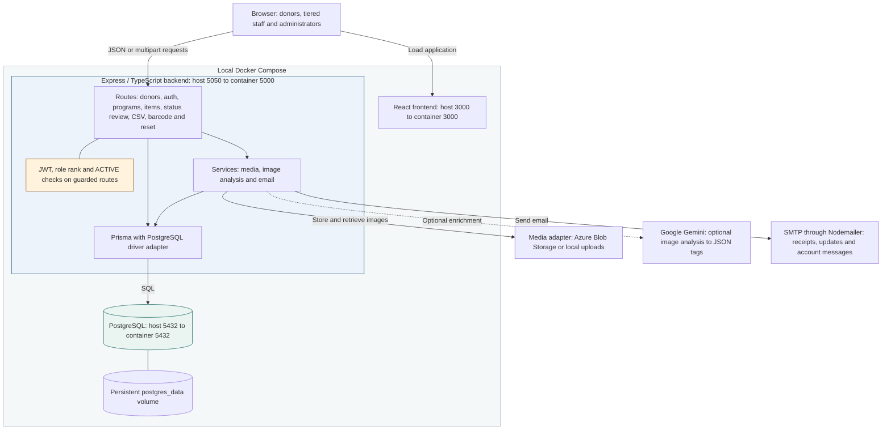

# Current system architecture and local deployment

**Material Derailleur / BWorks** · Source snapshot: `3c75abdc` · October 19, 2026

One Express backend supports the React application, PostgreSQL persistence and external integrations. This view documents the checked-in local Compose configuration.

- The backend starts after the database health check. AI and email calls currently run during requests.
- **Technical debt:** some mutation routes lack authorization checks. Local media returns `/uploads/...` URLs, but the API has no matching static mount.
- This is a development deployment. The separate CloudFormation scaffold does not establish a verified production topology.

**Sources:** [API composition](../../server/src/index.ts#L69), [Compose](../../docker-compose.yml), [media adapter](../../server/src/services/donatedItemService.ts#L12), [AI service](../../server/src/services/imageAnalysisService.ts#L140), [email service](../../server/src/services/emailService.ts#L9).

[Checkpoint index](README.md) · [One-page context](context.md) · [Source map and text equivalent](source-map.md#01--current-architecture-and-local-deployment)
