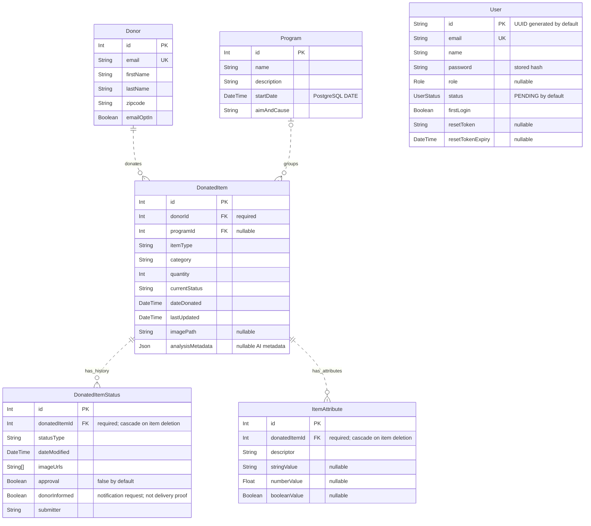

# Current data model

Material Derailleur / BWorks · October 19, 2026 · Repository snapshot `3c75abdc`

Six entities from the current Prisma schema. Representative fields show keys, item ownership, optional program assignment and reviewable history.

Each item has exactly one donor and zero or one program. Donors and programs may have no items. Each status or attribute belongs to exactly one item; an item may have zero or many of each. Dashed associations mean the child has its own primary key; `PK`, `FK` and `UK` mean primary, foreign and unique key. Deleting an item cascades to its status and attribute rows.

`User` and `Donor` have **no foreign key relationship**. The donor profile endpoint matches their email addresses in application code. `nullable` represents Prisma's `?`; the schema does not enforce exactly one populated value column per `ItemAttribute`. Account roles are ADMIN, DONOR, TIER_ONE, TIER_TWO and TIER_THREE; account statuses are PENDING, ACTIVE and SUSPENDED. Item status labels are strings, separate from account status and review approval.

Sources: [Prisma schema](../../server/prisma/schema.prisma#L37), [email-based profile lookup](../../server/src/routes/donorRoutes.ts#L359), [notification-intent assignment](../../server/src/routes/donatedItemStatusRoutes.ts#L149). See the [source map](source-map.md#02--current-data-model) for the text equivalent and further evidence.

[Checkpoint index](README.md) · [One-page context](context.md)
