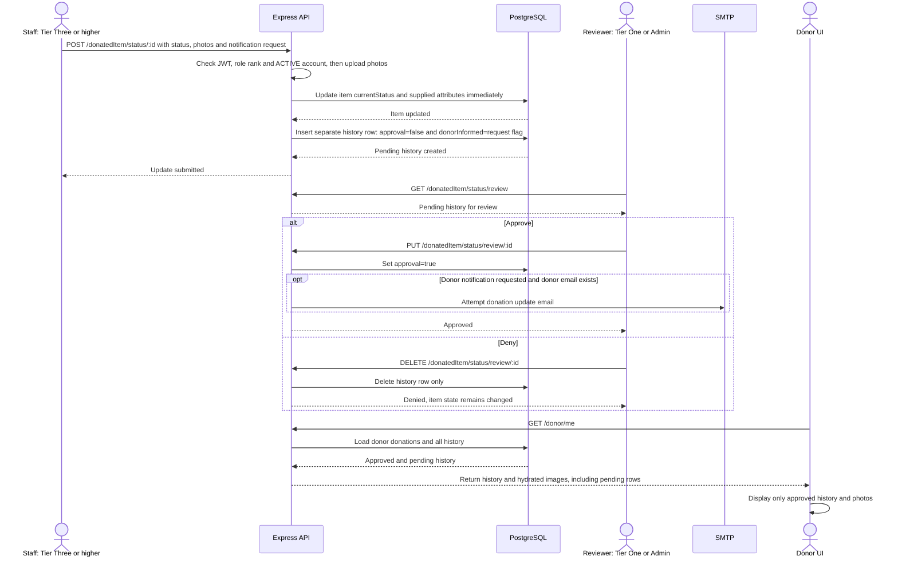

# Current status submission, review and donor visibility

**Material Derailleur / BWorks** · Source snapshot: `3c75abdc` · October 19, 2026

Approval controls donor timeline visibility in the UI and optional update email. The item changes before review.

- **Screens:** staff uses `/donations/:id` and `/donatedItem/status/:id`; reviewers use `/admin/image-approval`; donors use `/my-donations`.
- **Technical debt:** item mutation and history insertion are separate writes. Denial removes history without restoring item status or attributes. Pending-history filtering currently occurs in the donor component.
- `donorInformed` records a notification request, not successful delivery. SMTP errors are caught and logged by the email service.
- This view covers status updates. Intake separately attempts a receipt email immediately; business status labels are not an enforced sequential state machine.

**Sources:** [submission and review routes](../../server/src/routes/donatedItemStatusRoutes.ts#L92), [donor API](../../server/src/routes/donorRoutes.ts#L359), [donor history component](../../client-app/src/Components/DonorDonations.tsx#L170), [email handling](../../server/src/services/emailService.ts#L245).

[Checkpoint index](README.md) · [One-page context](context.md) · [Source map and text equivalent](source-map.md#03--current-status-submission-and-review)
