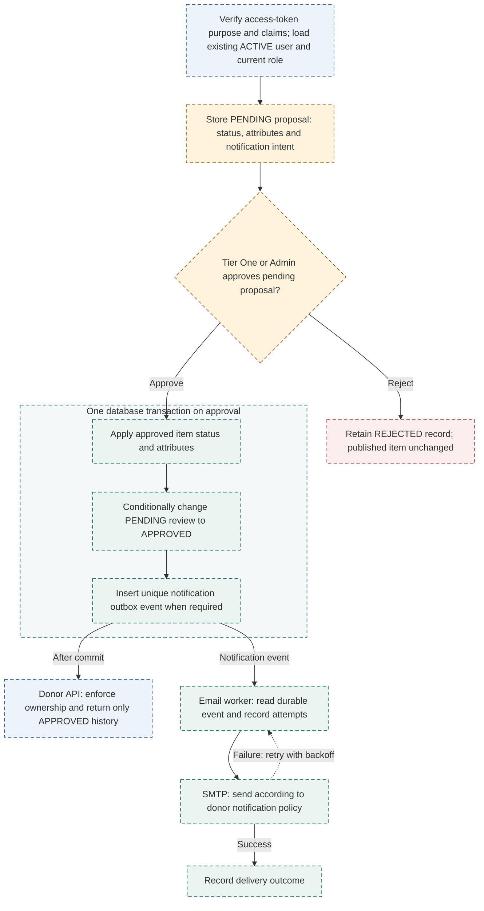

# Proposed approval and notification design

**Material Derailleur / BWorks** · Recommendation based on snapshot `3c75abdc` · October 19, 2026

**Proposed — not implemented.** Stage updates for review, apply approved changes atomically and track retryable email delivery. Dashed boxes identify proposed behavior.

- **Before implementation:** confirm publication/approval semantics and donor email preferences with BWorks; plan migration of existing pending history. Staging a proposal leaves the published item unchanged.
- **Consistency:** the transaction rolls back unless the pending review is accepted once. A unique event key prevents repeated approval from creating duplicate notification jobs. SMTP cannot guarantee exactly-once delivery after an ambiguous failure.
- **Trade-off:** explicit review/outbox data and a worker add operational work in exchange for consistent item history, retained rejections and observable email attempts.

**Basis:** the [current workflow](03-current-status-workflow.md) exposes separate item/history writes, deleted rejection history and notification intent without delivery tracking. These recommendations are not an agreed sprint commitment.

[Checkpoint index](README.md) · [One-page context](context.md) · [Source map and text equivalent](source-map.md#04--proposed-design-not-implemented)
